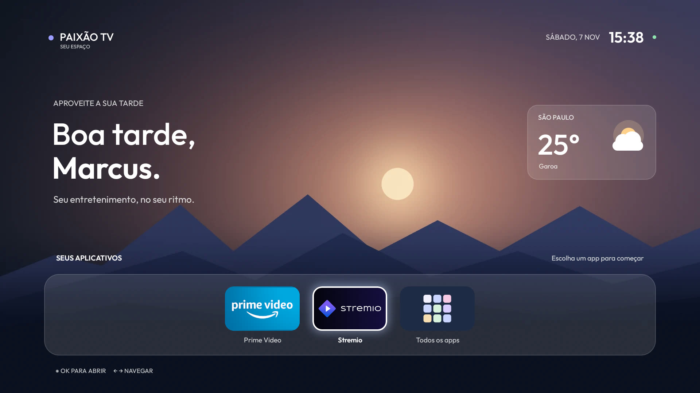
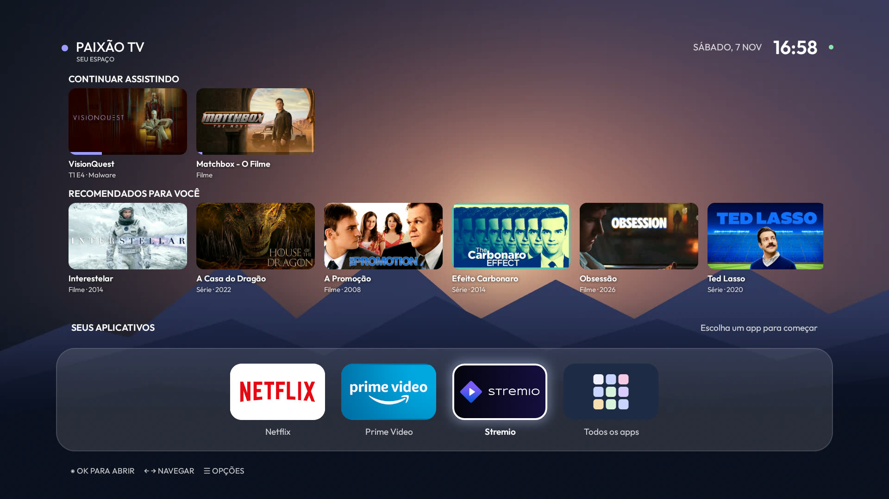
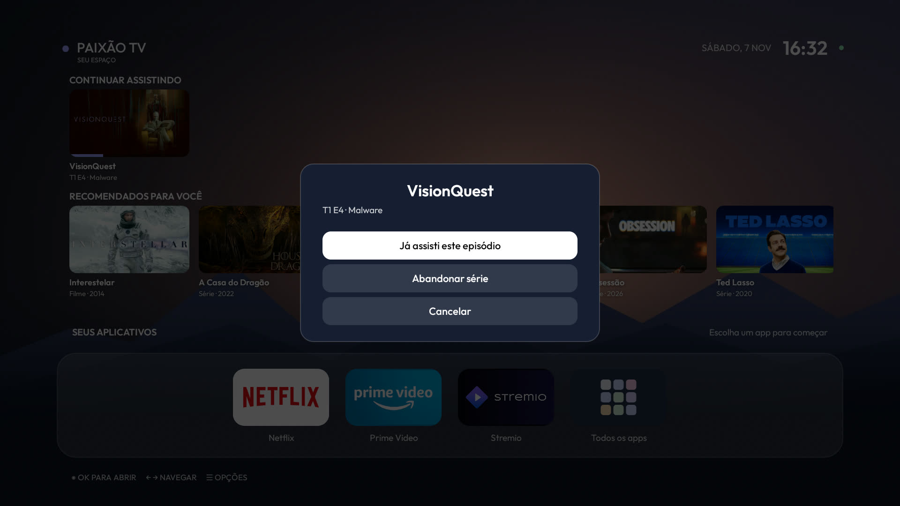
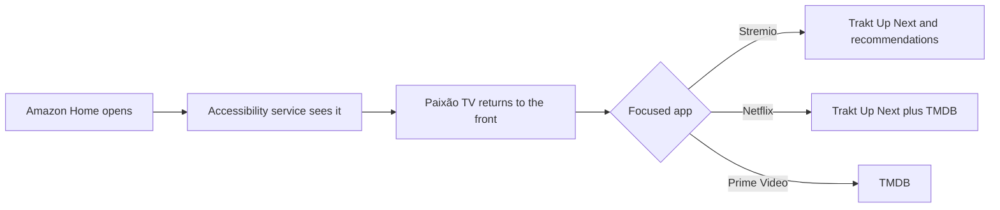

<h1 align="center">Paixão TV</h1>

<p align="center">
  <strong>A fast, clean home screen for an old Android-based Fire TV Stick.</strong><br>
  No root. Amazon's launcher stays installed, and everything is reversible.
</p>

<p align="center">
  English · <a href="README.pt-BR.md">Português (Brasil)</a>
</p>



## Why this exists

Newer Fire TV Sticks run Vega OS, which cannot sideload Android apps. An older stick still runs Android-based Fire OS and can, but its stock home screen is heavy: it plays video in the background, runs dozens of services and leaves little memory for the app you actually want to use.

So this project turned a 1 GB Fire TV Stick Lite into a focused streaming box:

1. Amazon's telemetry, ads and preloaded apps were disabled with a tested debloat list.
2. A tiny native launcher replaced the home screen.
3. Each app got its own content rows, fed by Trakt and TMDB.

| | Before | After |
|---|---|---|
| Stock launcher memory | 110 MB, in front | 21 MB, idle behind ours |
| Free RAM, right after boot | 128 MB (debloated, stock home) | 262 MB (first launcher, no content rows) |
| Free RAM, current launcher | - | About 150-225 MB, depending on open apps |
| Launcher size | - | 158 KB APK, no libraries |
| Home screen open | - | 188 ms (first launcher, warm start) |

Measured on one stick, in a single session. Treat them as an example, not a benchmark.

## What it does

- **Dock with your apps**, with a sliding focus ring. Pinned apps come first, and new ones appear by themselves.
- **Rows that follow the focused app:**
  - **Stremio:** Continue Watching and personal recommendations from Trakt.
  - **Netflix:** Continue Watching from Trakt, plus what is popular on Netflix.
  - **Prime Video:** popular movies and series.
- **Open straight into a title.** Stremio resumes the exact episode, Netflix opens the title page, and Prime Video opens a search.
- **☰ menu on Continue Watching cards.** Mark as watched, drop a series or remove a movie, synced to Trakt.
- **Scenes that follow the time of day**, a greeting and live weather.
- **All apps screen**, with Settings and the Appstore.

| Continue Watching and recommendations | Remove from Continue Watching |
|---|---|
|  |  |

## Status

Personal project, tested on **one device**: Fire TV Stick Lite (`AFTSS`, `sheldon`), Fire OS 7.7.1.7, Android 9, 32-bit.

| Works | Not tested yet |
|---|---|
| Boot into the launcher, Home key, reboot | Days of real daily use |
| Debloat kept after reboot | "Drop series" and "Mark as watched" writes |
| Trakt read, and removing a movie from the ☰ menu | Pressing Home during a movie: the progress may not reach Trakt |
| Stremio resume by deep link | Prime Video search from a card, on the current version |
| Netflix title link, when an ID exists | |

The interface text is in Brazilian Portuguese. Other Fire TV models and firmware may behave differently.

## How it works



### Taking over Home without root

Fire OS ignores any other launcher, even after `set-home-activity`, and Amazon's launcher cannot be disabled. So `GuardService` watches for Amazon's home window and brings this launcher back under a black cover. If anything fails, the cover drops after four seconds and you see Amazon's home, never a black screen.

The service reads only the name of the active app, never screen content. Amazon's launcher stays in memory, but idle.

### Continue Watching

The first version used `/sync/playback`, which keeps everything ever paused, including shows you abandoned. The right source is **`/sync/progress/up_next`**, the list Trakt's own site shows. Playback data now only adds the progress bar and paused movies, and shows you dropped are filtered from the recommendations.

Trakt has no source field, so the launcher asks TMDB whether Netflix Brazil streams a title. If it does, and it was paused after you linked Netflix, it goes to the Netflix row. It is a heuristic: a Netflix title watched in Stremio lands on the wrong row.

### Opening a title

| App | Link | Note |
|---|---|---|
| Stremio | `stremio:///detail/series/<imdb>/<imdb>:<season>:<episode>?autoPlay=true` | Resumes where you stopped |
| Netflix | `https://www.netflix.com/title/<id>`, flags `0x10808000`, extra `source=30` | The ID comes from [Wikidata](https://www.wikidata.org/wiki/Property:P1874), one batched query. Search links are ignored |
| Prime Video | `https://app.primevideo.com/search?phrase=<title>` | Search only: there is no free source for its IDs |

### What did not work

Knowing this may save you some time:

| Attempt | Result |
|---|---|
| Closing Stremio and Prime Video with `killBackgroundProcesses` | Netflix closes. Stremio's foreground server and Prime Video stay |
| Launcher connecting to its own ADB to run `am force-stop` | Fire OS drops the connection on the first packet, from loopback and from the LAN address |
| Accessibility click on "Force stop" in App Info | Click accepted, nothing happens. Only a real key press works, and `stopped=true` proves it |
| Root | The known `sheldon` exploit [requires Fire OS below 7.2.7.3](https://liliputing.com/turn-amazons-first-tv-stick-into-an-unofficial-android-tv-device-with-lineageos-18-1/) |

## Setup

You need a Fire OS 7 stick, a computer with `adb`, Python 3, and JDK 17 with Android SDK 34 on the machine that builds.

### 1. Enable ADB on the stick

Settings > My Fire TV > Developer Options > ADB Debugging. Keep the stick's IP address.

### 2. Debloat, optional but recommended

Use the [CleanYourTV](https://github.com/Gathin23/cleanyourtv) list for your model. It disables packages instead of removing them, and comes with a restore script. This project used `examples/amazon-fire-tv-stick-lite-2020`.

### 3. Configure

```bash
cp local.properties.example local.properties
```

Fill in your name, city and keys. `local.properties` is ignored by Git.

| Value | Where to get it |
|---|---|
| `traktClientId` | [Create a Trakt app](https://trakt.tv/oauth/applications/new) with redirect URI `http://localhost:8765/callback` |
| TMDB key | [TMDB API settings](https://www.themoviedb.org/settings/api). Save the v3 key in `tmdb.txt`, which is also ignored by Git |

### 4. Build

```bash
./gradlew assembleRelease
```

If you prefer Docker, CleanYourTV's `tools/docker-build.sh` provides JDK 17 and SDK 34. Copy this project to its `addons/` folder and pass that path.

### 5. Sign in to Trakt

```bash
python3 tools/trakt_auth.py <trakt client id> trakt-token.json
```

Open the printed link and approve it. PKCE needs no client secret.

### 6. Install

```bash
FIRE_TV=192.168.1.50 tools/deploy.sh
```

Accept the debugging prompt on the TV the first time. The script installs the APK, turns on the accessibility service and hands `trakt-token.json` and `tmdb.txt` to the app, which reads each one and deletes it from shared storage.

> [!IMPORTANT]
> After every reinstall the accessibility service must be switched off and on with a two-second pause, or it keeps stale capabilities and the screen stays on Amazon's home. `deploy.sh` does this for you.

## Undo

```bash
adb -s <stick ip>:5555 shell settings put secure enabled_accessibility_services null
adb -s <stick ip>:5555 uninstall dev.leanhome
adb -s <stick ip>:5555 shell settings delete global alarm_manager_constants
```

Amazon's home returns at once. To undo the debloat, use CleanYourTV's `tools/restore.sh`.

## Security

- **Network ADB on port 5555 is plaintext.** Anyone on your network who gets past the prompt on the TV can control the stick. Keep it off when you do not need it, and never expose it to the internet.
- **Credentials stay out of this repository.** They live in `local.properties`, `tmdb.txt` and `trakt-token.json`, all ignored by Git. The Trakt token ends up in the app's private storage, but your client ID and the launcher's settings are in the APK you build, so do not publish that APK.

## Credits

- [CleanYourTV](https://github.com/Gathin23/cleanyourtv) by Gathin: debloat list, tools and the build image. MIT.
- [hrudek/cleanyourtv](https://github.com/hrudek/cleanyourtv/tree/firetv) and [humblemuzzu/dumbtv](https://github.com/humblemuzzu/dumbtv): the Home redirect approach. MIT.
- [Outfit](https://fonts.google.com/specimen/Outfit): font, under the [SIL Open Font License](FONT-LICENSE-OFL.txt).
- [Trakt](https://trakt.tv), [TMDB](https://www.themoviedb.org), [Wikidata](https://www.wikidata.org) and [Open-Meteo](https://open-meteo.com): data.

This product uses the TMDB API but is not endorsed or certified by TMDB.

Built with [Claude Code](https://claude.com/claude-code).

## Disclaimer

Not affiliated with Amazon, Netflix, Stremio, Trakt or TMDB. Product names and logos belong to their owners. You need your own accounts and subscriptions. Use at your own risk: Fire OS updates can break the Home redirect at any time.

## License

[MIT](LICENSE)
