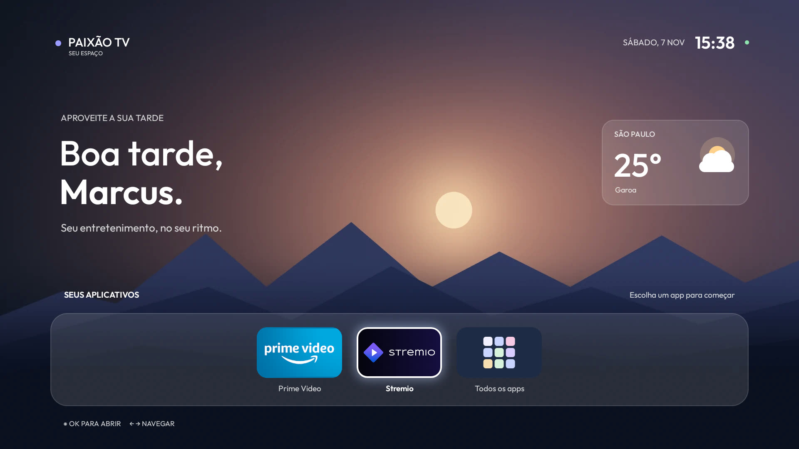
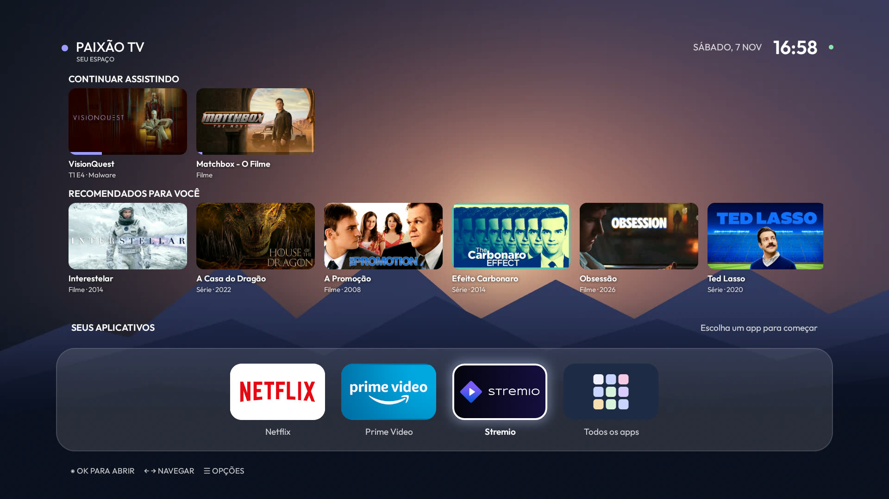
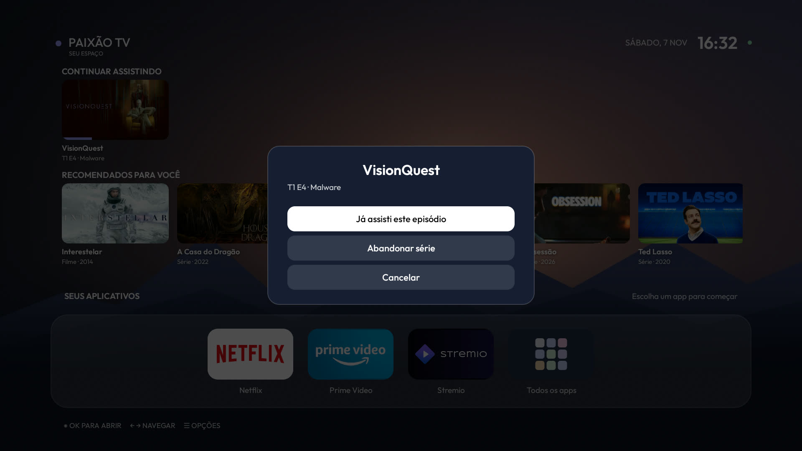
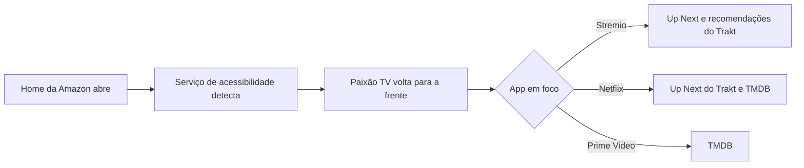

<h1 align="center">Paixão TV</h1>

<p align="center">
  <strong>Uma tela inicial rápida e limpa para Fire TV Stick antigo, baseado em Android.</strong><br>
  Sem root. O launcher da Amazon continua instalado, e tudo é reversível.
</p>

<p align="center">
  <a href="README.md">English</a> · Português (Brasil)
</p>



## Por que isso existe

Os Fire TV Sticks mais novos usam Vega OS, que não instala apps Android por fora. Um stick antigo ainda usa Fire OS, baseado em Android, e instala, mas a tela inicial original é pesada: reproduz vídeo em segundo plano, roda dezenas de serviços e sobra pouca memória para o app que você quer usar.

Este projeto transformou um Fire TV Stick Lite de 1 GB em um aparelho de streaming focado:

1. A telemetria, os anúncios e os apps pré-instalados da Amazon foram desativados com uma lista testada.
2. Um launcher nativo minúsculo substituiu a tela inicial.
3. Cada app ganhou linhas de conteúdo próprias, alimentadas por Trakt e TMDB.

| | Antes | Depois |
|---|---|---|
| Memória do launcher original | 110 MB, na frente | 21 MB, parado no fundo |
| RAM livre logo após ligar | 128 MB (com debloat e Home original) | 262 MB (primeiro launcher, sem linhas) |
| RAM livre, launcher atual | - | Cerca de 150 a 225 MB, conforme os apps abertos |
| Tamanho do launcher | - | APK de 158 KB, sem bibliotecas |
| Abertura da tela inicial | - | 188 ms (primeiro launcher, início quente) |

Medições feitas em um único aparelho, em uma sessão. Veja como exemplo, não como benchmark.

## O que ele faz

- **Dock com seus apps** e anel de foco deslizante. Os fixos vêm primeiro, e apps novos aparecem sozinhos.
- **Linhas que acompanham o app em foco:**
  - **Stremio:** Continuar Assistindo e recomendações pessoais do Trakt.
  - **Netflix:** Continuar Assistindo do Trakt e o que está em alta na Netflix.
  - **Prime Video:** filmes e séries em alta.
- **Abre direto no título.** O Stremio retoma o episódio exato, a Netflix abre a página do título e o Prime Video abre uma busca.
- **Menu ☰ nos cards de Continuar Assistindo.** Marque como assistido, abandone a série ou remova um filme, com sincronização no Trakt.
- **Cenas conforme o horário**, saudação e clima em tempo real.
- **Tela Todos os apps**, com Configurações e Appstore.

| Continuar Assistindo e recomendações | Remover do Continuar Assistindo |
|---|---|
|  |  |

## Situação

Projeto pessoal, testado em **um aparelho**: Fire TV Stick Lite (`AFTSS`, `sheldon`), Fire OS 7.7.1.7, Android 9, 32 bits.

| Funciona | Ainda não testado |
|---|---|
| Início no launcher, botão Início e reboot | Dias de uso real |
| Debloat mantido após reboot | Gravação de "Abandonar série" e "Já assisti" |
| Leitura do Trakt e remoção de filme pelo menu ☰ | Apertar Início no meio de um filme: o progresso pode não chegar ao Trakt |
| Retomada do Stremio por link direto | Busca do Prime Video pelo card, na versão atual |
| Link de título da Netflix, quando existe ID | |

A interface está em português do Brasil. Outros modelos de Fire TV e firmwares podem se comportar de outra forma.

## Como funciona



### Assumir a Home sem root

O Fire OS ignora qualquer outro launcher, mesmo depois de `set-home-activity`, e o launcher da Amazon não pode ser desativado. Por isso, o `GuardService` observa a janela da Home da Amazon e traz este launcher de volta sob uma cobertura preta. Se algo falhar, a cobertura sai em quatro segundos e você vê a Home da Amazon, nunca uma tela preta.

O serviço lê apenas o nome do app ativo, nunca o conteúdo da tela. O launcher da Amazon continua na memória, mas parado.

### Continuar Assistindo

A primeira versão usava `/sync/playback`, que guarda tudo que já foi pausado, inclusive o que você largou. A fonte certa é **`/sync/progress/up_next`**, a mesma lista do site do Trakt. O `playback` agora só acrescenta a barra de progresso e os filmes pausados, e as séries abandonadas saem das recomendações.

O Trakt não informa a origem do que foi assistido, então o launcher pergunta ao TMDB se a Netflix Brasil tem o título. Se tiver, e ele tiver sido pausado depois de você conectar a Netflix, vai para a linha da Netflix. É uma aproximação: um título da Netflix assistido no Stremio cai na linha errada.

### Abrir um título

| App | Link | Observação |
|---|---|---|
| Stremio | `stremio:///detail/series/<imdb>/<imdb>:<temporada>:<episódio>?autoPlay=true` | Retoma de onde parou |
| Netflix | `https://www.netflix.com/title/<id>`, flags `0x10808000`, extra `source=30` | O ID vem do [Wikidata](https://www.wikidata.org/wiki/Property:P1874), em uma consulta em lote. Links de busca são ignorados |
| Prime Video | `https://app.primevideo.com/search?phrase=<título>` | Só busca: não há fonte gratuita para os IDs |

### O que não funcionou

Isso pode poupar seu tempo:

| Tentativa | Resultado |
|---|---|
| Fechar Stremio e Prime com `killBackgroundProcesses` | A Netflix fecha. O servidor em primeiro plano do Stremio e o Prime ficam |
| Launcher conectar ao próprio ADB para rodar `am force-stop` | O Fire OS derruba a conexão no primeiro pacote, por loopback e pelo IP da rede |
| Clique de acessibilidade em "Forçar a interrupção" | Clique aceito, nada acontece. Só tecla real funciona, e `stopped=true` comprova |
| Root | O exploit conhecido do `sheldon` [exige Fire OS abaixo de 7.2.7.3](https://liliputing.com/turn-amazons-first-tv-stick-into-an-unofficial-android-tv-device-with-lineageos-18-1/) |

## Instalação

Você precisa de um stick com Fire OS 7, um computador com `adb`, Python 3 e, na máquina que compila, JDK 17 com Android SDK 34.

### 1. Ative o ADB no stick

Configurações > Meu Fire TV > Opções do desenvolvedor > Depuração ADB. Anote o IP do aparelho.

### 2. Debloat, opcional mas recomendado

Use a lista do [CleanYourTV](https://github.com/Gathin23/cleanyourtv) para o seu modelo. Ela desativa pacotes em vez de remover, e tem script de restauração. Este projeto usou `examples/amazon-fire-tv-stick-lite-2020`.

### 3. Configure

```bash
cp local.properties.example local.properties
```

Preencha seu nome, cidade e chaves. O `local.properties` fica fora do Git.

| Valor | Onde conseguir |
|---|---|
| `traktClientId` | [Crie um app no Trakt](https://trakt.tv/oauth/applications/new) com Redirect URI `http://localhost:8765/callback` |
| Chave do TMDB | [Configurações de API do TMDB](https://www.themoviedb.org/settings/api). Salve a chave v3 em `tmdb.txt`, que também fica fora do Git |

### 4. Compile

```bash
./gradlew assembleRelease
```

Se preferir Docker, o `tools/docker-build.sh` do CleanYourTV traz JDK 17 e SDK 34. Copie este projeto para a pasta `addons/` dele e informe esse caminho.

### 5. Entre no Trakt

```bash
python3 tools/trakt_auth.py <client id do trakt> trakt-token.json
```

Abra o link exibido e autorize. O PKCE não precisa de client secret.

### 6. Instale

```bash
FIRE_TV=192.168.1.50 tools/deploy.sh
```

Aceite o aviso de depuração na TV na primeira vez. O script instala o APK, liga o serviço de acessibilidade e entrega `trakt-token.json` e `tmdb.txt` ao app, que lê cada um e apaga do armazenamento compartilhado.

> [!IMPORTANT]
> Depois de cada reinstalação, o serviço de acessibilidade precisa ser desligado e religado com uma pausa de dois segundos. Sem isso, ele mantém permissões antigas e a tela fica na Home da Amazon. O `deploy.sh` já faz esse passo.

## Desfazer

```bash
adb -s <ip do stick>:5555 shell settings put secure enabled_accessibility_services null
adb -s <ip do stick>:5555 uninstall dev.leanhome
adb -s <ip do stick>:5555 shell settings delete global alarm_manager_constants
```

A Home da Amazon volta na hora. Para desfazer o debloat, use o `tools/restore.sh` do CleanYourTV.

## Segurança

- **O ADB de rede na porta 5555 não tem criptografia.** Quem estiver na sua rede e passar pelo aviso na TV pode controlar o stick. Deixe desligado quando não precisar e nunca exponha à internet.
- **As credenciais ficam fora deste repositório.** Elas vivem em `local.properties`, `tmdb.txt` e `trakt-token.json`, todos ignorados pelo Git. O token do Trakt vai para o armazenamento privado do app, mas seu client ID e as configurações do launcher ficam no APK que você compilar, então não publique esse APK.

## Créditos

- [CleanYourTV](https://github.com/Gathin23/cleanyourtv), de Gathin: lista de debloat, ferramentas e imagem de build. MIT.
- [hrudek/cleanyourtv](https://github.com/hrudek/cleanyourtv/tree/firetv) e [humblemuzzu/dumbtv](https://github.com/humblemuzzu/dumbtv): a forma de redirecionar a Home. MIT.
- [Outfit](https://fonts.google.com/specimen/Outfit): fonte, sob a [SIL Open Font License](FONT-LICENSE-OFL.txt).
- [Trakt](https://trakt.tv), [TMDB](https://www.themoviedb.org), [Wikidata](https://www.wikidata.org) e [Open-Meteo](https://open-meteo.com): dados.

Este produto usa a API do TMDB, mas não é endossado nem certificado pelo TMDB.

Feito com [Claude Code](https://claude.com/claude-code).

## Aviso

Sem vínculo com Amazon, Netflix, Stremio, Trakt ou TMDB. Nomes e logos pertencem aos seus donos. Você precisa das suas próprias contas e assinaturas. Use por sua conta e risco: atualizações do Fire OS podem quebrar o redirecionamento da Home a qualquer momento.

## Licença

[MIT](LICENSE)
